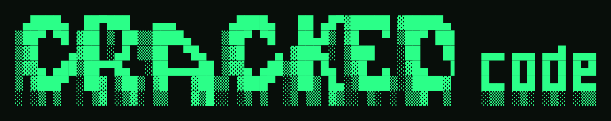

<p align="center"></p>

# Cracked Code

**Website: [cracked.gaddgames.co.uk](https://cracked.gaddgames.co.uk)**

A small, fast coding agent for the terminal, **built for Qwen3.8 Flash-Next on
[Strata](https://github.com/Niko1221/Strata)**, on Linux, with Windows in beta. Qwen3.8 on Strata is the only
model and server tuned and tested before a release; others work, best effort (see Requirements). Pure Python, two small dependencies (`prompt_toolkit` for the
prompt, `pygments` for code colours), native tool calling, about 1,100 tokens of fixed prompt.

On a local GPU every prompt token costs reading time, so Cracked keeps the prompt lean and the turns few. On the
same 11-task suite (68 checks), with the same model, every harness scored 68/68. Cracked was the fastest and used
7–10× fewer tokens:

| Harness (2026-11-07, median of 3 runs) | Qwen3.8 Flash-Next (Strata, local) | GLM 5.3 Flash (cloud) | DeepSeek V4.1 Flash (cloud) |
|---|---|---|---|
| **Cracked Code** | **404 s** · 174k tok | **126 s** · 134k tok | **80 s** · 159k tok |
| Claude Code | 592 s · 1.43M tok | 144 s · 1.27M tok | 137 s · 1.10M tok |
| Qwen Code | 825 s · 1.74M tok | 359 s · 1.30M tok | 167 s · 1.31M tok |

The local runs were on one RTX 5070 Ti (16 GB) with Qwen3.8 Flash-Next IQ3_S. The suite itself is not in this repo yet.

Design stance: the harness has no opinion about what the model may work on. It has exactly one behavioural
rule, *don't wreck the work*, and three mechanical safeties so that damage is always recoverable.

## Requirements

- **Linux**, or **Windows 10/11 in beta** with Git for Windows (the model's shell commands run in Git Bash).
  Windows runs the offline tests in CI and has a tested setup with Ollama: [docs/windows.md](docs/windows.md).
  macOS may work but is untested and unsupported.
- Python 3.11 or newer.
- A server with an OpenAI-compatible `/v1/chat/completions` and native tool calls. **Tested:** Strata serving
  Qwen3.8 Flash-Next. **Best effort:** llama.cpp's `llama-server`, Ollama, LM Studio, vLLM and hosted APIs. These
  work by setting `base_url`, but they are not tuned or tested before a release, and a weak model fails at tool
  calls whatever the harness does.

## Install

```bash
pipx install cracked-code        # or: uv tool install cracked-code
```

Before it is on PyPI, or for a fixed version: `uv tool install git+https://github.com/LGadd/Cracked-Code.git@v0.1.0`.
Windows: see [docs/windows.md](docs/windows.md). From a checkout: `uv venv .venv && uv pip install --python .venv/bin/python -e .`, then `.venv/bin/cracked`.

## 60-second start

```bash
# 1. have Strata serving Qwen3.8 on its default port
curl -s http://127.0.0.1:8080/v1/models      # confirm it is up

# 2. run it: no config needed, the model, window and image support are read from Strata
cd /path/to/your/project
cracked                                       # REPL
cracked -p "add a --verbose flag to cli.py"   # one shot
cracked -c                                    # carry on with this folder's last session
cracked --show-config                         # every setting and where it came from
```

Settings, when you want them, live in `~/.config/cracked/config.toml`: see [docs/setup.md](docs/setup.md). For
another server:

```toml
base_url = "http://127.0.0.1:8081/v1"   # llama-server, Ollama (:11434), LM Studio (:1234) ...
model = "my-model"                      # only if the server serves several
api_key_env = "OPENROUTER_API_KEY"      # only for a hosted API: the env var that holds the key
```

## Safety: read this first

Cracked runs shell commands **on your machine, unsandboxed**. The model can do anything your user can do.

1. **Approvals:** reads never ask. In manual mode (the default), edits and overwrites ask, with the diff shown first.
   New files and appends don't ask. `delete_file` always asks, even in Fuck It Mode.
2. **Deny-list:** 9 regexes for the unrecoverable only (`rm -rf /`, `mkfs`, `dd of=/dev/…`, `reboot`, fork bomb, …).
   It is a seatbelt, **not a security boundary**: everything else runs.
3. **Git snapshots:** before every turn the workspace is committed to a separate repo in
   `~/.local/share/cracked/snapshots/`, so your own git history stays clean. `/undo` and `/diff` use it. Images,
   video, audio, `node_modules/` (`snapshot_skip`) and files over 20 MB (`snapshot_max_mb`) are left out, so they
   cannot be undone.

There is no refusal layer, no persona and no values in the prompt. Point it at a project folder, not your home
folder (it warns you), and use a VM or container for anything you can't afford to lose. `scripts/jail.sh` is the
bubblewrap jail the live tests use. [docs/gotchas.md](docs/gotchas.md) has the exact limits of each safety.

## Using it

Type a task at `>_`. While it runs, one spinner line says what the model is doing (reading, thinking, writing, or
which tool), and each finished tool call is one line. The answer comes under a neon bar, and a rule closes the task
with its time and the files changed. **Ctrl+O** shows full detail (reasoning, turns, diffs). **Esc** stops the
task. Type while it works and press Enter to steer it: the model reads your message before its next step.

**Shift+Tab** cycles the mode:
- **manual**: approvals ask
- **Fuck It**: everything auto-approved (deletes still ask)
- **INVESTIGATE**: read only. It reads, reports what it found, then stops.

`/help` lists everything. The ones you will use most:

| Command | What it does |
|---|---|
| `/undo` | the files back to before the last task, and the model forgets it |
| `/diff` | everything changed this session |
| `/plan <goal>` | research and write a plan (read-only), then run it step by step |
| `/btw <question>` | a side question answered from the conversation, not kept |
| `/init` | draft a `CRACKED.md` (project rules) from the repo |
| `/incognito` | web search and fetch off, and out of every request (saves ~150 tokens each); again to turn back on |
| `/model` | list the server's models, or `/model <id>` to switch for this session |
| `/turns N` | most model round trips per task (-1 = no limit) |
| `/clear` | start a new conversation (the old one stays saved) |
| `/resume`, `/context`, `/copy`, `/export` | the last session, what fills the context, copy the last answer, save the chat as markdown |
| `!cmd` | your own shell command; the output is not sent to the model |
| `@path` | send a file with the task (Tab completes; `@pars` finds files anywhere) |

### Keys

| Key | What it does |
|---|---|
| **Enter** | send. End a line with `\` (or press **Alt+Enter**) for a new line; pasted text keeps its newlines |
| **Ctrl+X Ctrl+E** | write the task in `$EDITOR` |
| **Up/Down**, **Ctrl+R** | past tasks, and search them |
| **Ctrl+C** | clear the line |
| **Shift+Tab** | change mode, also mid-task |
| **Ctrl+O** | details: reasoning, every turn, diffs. Toggles, and replays the session in the other view |
| **Esc** | stop the task. The conversation is kept: type to carry on, or `/undo` |
| **Ctrl+B** | move a running shell command to the background (`/jobs` lists and kills them) |
| type + **Enter** mid-task | steer it; `+ something` adds a step to a running plan |

### Modes for long and quick tasks

Set these in `~/.config/cracked/config.toml`:

- **LOCKED IN** (`locked_in = true`): for long tasks. Every ask (queued messages too), failed call and changed file
  is kept in a ledger that is restated every 10 turns and survives compaction, so nothing you asked for gets lost.
  A little slower, because the history stays bigger. A running session picks up the change at its next turn.
- **ONE SHOT** (`one_shot = true`): the model makes the change and stops, with no tests, builds or re-reads to
  confirm. You test it. The harness's own syntax check on `.py`, `.json` and `.js` writes still runs. New sessions only.
- **Auto checklist** (`auto_checklist = true`): a long task without a checklist (8 turns, or right after a
  compaction) gets one, and the harness walks the model through it step by step, like `/plan`.

### Images

With a vision model (Cracked reads this from the server), attach an image with `@shot.png` in a task or
`cracked --image shot.png -p "…"`, and the model can open images itself with `see_image`. Images over the size cap are shrunk to
1024 px JPEG first (needs `ffmpeg`).

### Context, kept small for you

- Tool output over 6,000 characters goes to a file; only a preview enters the context, and the model reads the rest if it needs it.
- The history is compacted automatically at 40% of the window (`compact_at`).
- Once the prompt passes 24,000 tokens, finished tasks fold down to the ask and the answer.
- **Loop check:** 4 failed calls in a row, the same call 3 times, or editing one file over and over makes the model
  stop and rethink. If it is still stuck, it asks you for a hint instead of burning turns.

### Command line

```bash
cracked                          # interactive, in the current folder
cracked -p "task"                # one task and exit; repeat -p to run several tasks in one session
cracked -c                       # carry on with this folder's last session (sessions save after every task)
cracked --yes                    # start in Fuck It Mode
cracked --workspace ~/proj       # work in another folder
cracked --image shot.png -p "…"  # attach an image (repeatable)
cracked --max-turns 40           # stop and report after 40 model round trips
cracked --show-config            # every setting and where it came from
```

### Handy settings

All of them, with defaults, are in [docs/setup.md](docs/setup.md). The ones people change most:

| Key | Default | What it does |
|---|---|---|
| `theme` | `"dark"` | `"light"` for a light terminal background |
| `narrate` | `false` | one short "what I'm doing" line per turn, shown as `● …` |
| `bell` | `true` | ring the terminal bell when a task ends or an approval waits |
| `snapshot` | `true` | `false` turns snapshots off (no `/undo` or `/diff`) |
| `auto_think` | `true` | thinking at medium effort, capped per turn; `false` = the model's own default |
| `max_turns` | `-1` | model round trips per task; -1 = no limit |

## Project rules: CRACKED.md

Put rules for the model in `CRACKED.md` at the workspace root (it falls back to `AGENTS.md`). Rules for every
project go in `~/.config/cracked/CRACKED.md`. Both are added to the system prompt at startup. Skills are just `.md`
files the model reads when a rule tells it to:

```markdown
## Skills: read the file before starting a matching task
| When the task is about…                        | Read first          |
|------------------------------------------------|---------------------|
| making, editing or rendering a JS/canvas video | skills/js-video.md  |
```

## Tools

| Tool | What it does |
|---|---|
| `read_file` | read a text file, `offset`/`limit` lines |
| `write_file` | write a whole file, creates parent dirs |
| `edit_file` | replace one exact, unique occurrence, or a list of `edits` to one file (all or none) |
| `replace_def` | replace a Python function or class by name, without retyping the old code |
| `delete_file` | delete one file: **always asks** |
| `run_shell` | run a command in the workspace: exit code + output, long output spills to a file |
| `see_image` | look at an image (offered only when the server lists image input for the model) |
| `web_search` / `web_fetch` | DuckDuckGo search and URL fetch, no API keys |

Anything else (git, compilers, curl, python) goes through `run_shell`, so the tool set stays small.

## Optional: Telegram pings

With `TG_TOKEN=...` and `TG_CHAT=...` in `~/.config/cracked-code/telegram.env`, Cracked messages you when a task
finishes (with the files changed) or a question has waited 15 s. No file, no messages.

## Tests

```bash
python3 -m unittest discover -s tests -t .    # offline: no model or network needed
live-tests/run-all.sh                         # 7 live tests against a real model, in a bubblewrap jail
```

## Docs

- [docs/setup.md](docs/setup.md): every config key, env vars, the test jail
- [docs/gotchas.md](docs/gotchas.md): measured traps, read before you debug
- [docs/implemented.md](docs/implemented.md): how each part works, with the test evidence
- [docs/plan-mode.md](docs/plan-mode.md): the design of `/plan` and the checklist runner
- [docs/windows.md](docs/windows.md): Windows (beta): the tested setup, install steps, what differs
- [CHANGELOG.md](CHANGELOG.md) · [CONTRIBUTING.md](CONTRIBUTING.md)

The docs mention a web dashboard (a live view of the model, GPU and sessions, plus mode switches). It is not in this
release yet.

## License

MIT
